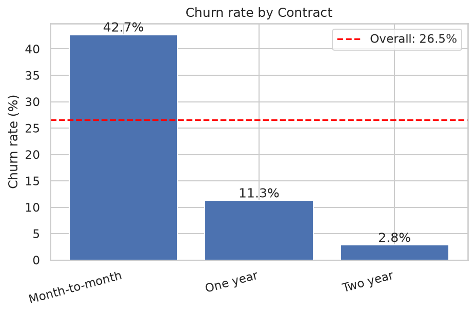
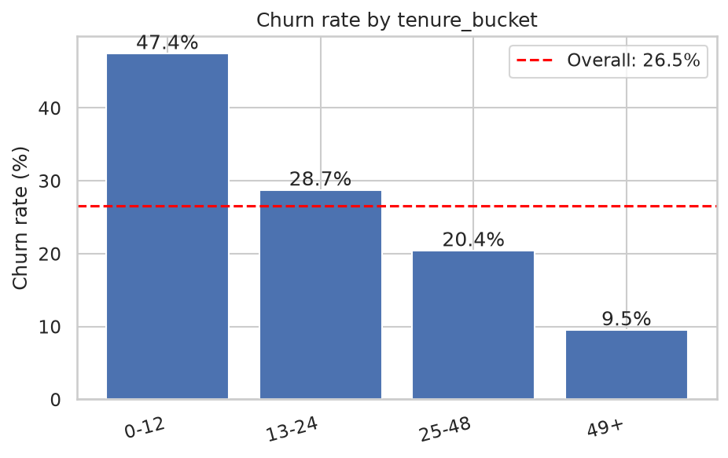
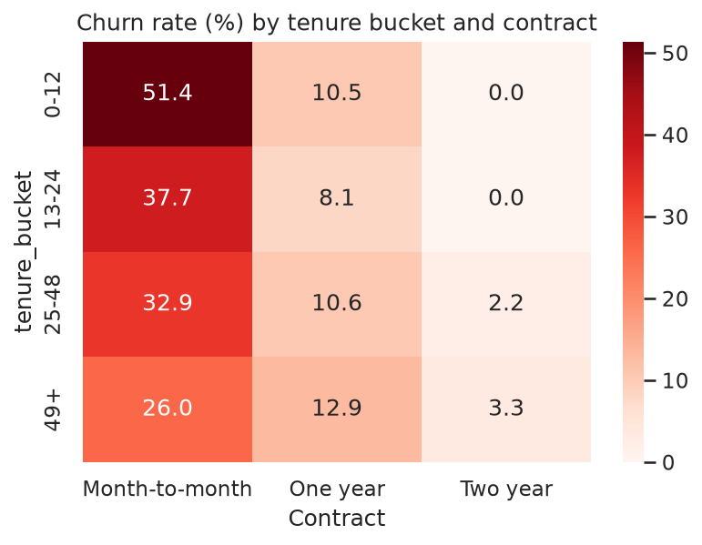
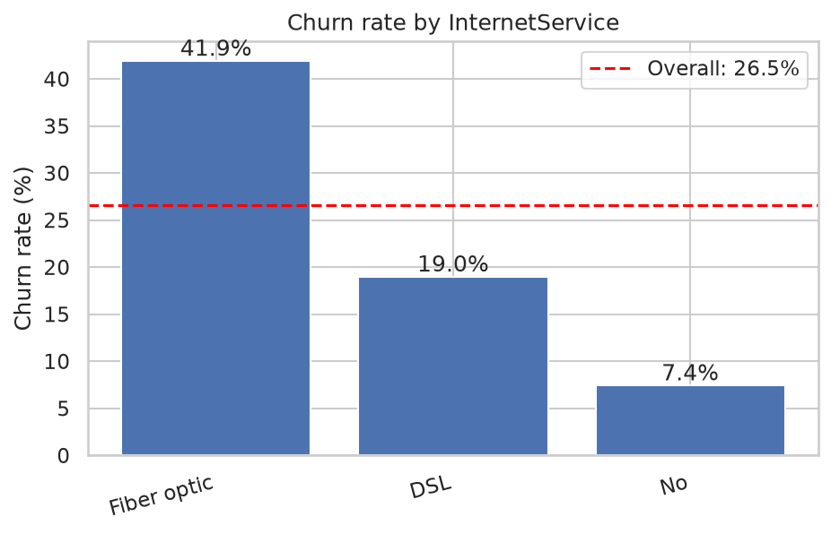
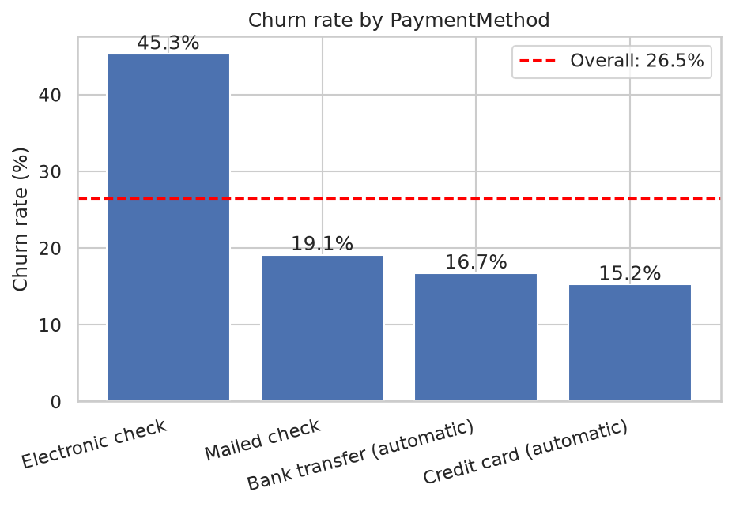
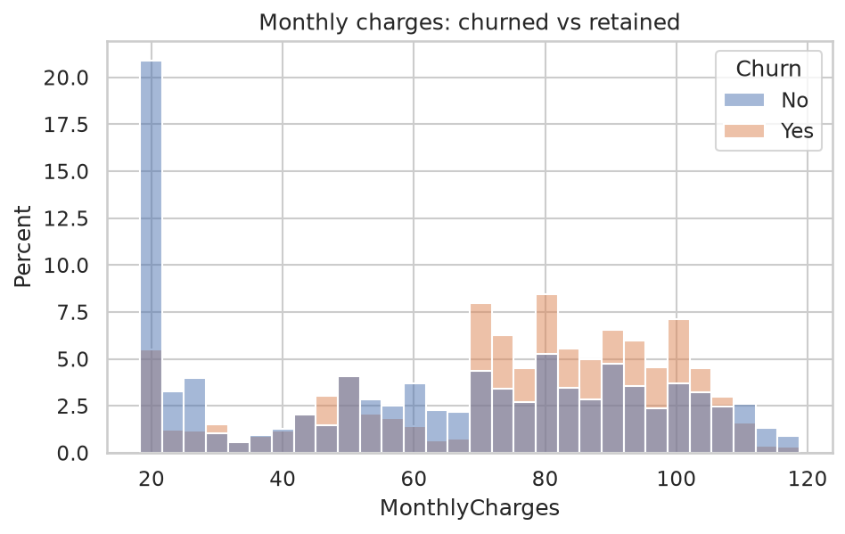

# Customer Churn & Retention Analysis

**Goal:** Find which telecom customer segments churn most, quantify the gaps, and recommend where a retention team should act first.

**Dataset:** [Telco Customer Churn (Kaggle, blastchar)](https://www.kaggle.com/datasets/blastchar/telco-customer-churn). 7,043 customers and 21 columns. The raw CSV is not stored in this repo; see *How to run*.

**Tools:** Python (pandas, Matplotlib, Seaborn), SQL (SQLite with CTEs and window functions)

---

## Stakeholder summary

Overall churn is **26.54%** (1,869 of 7,043 customers). Churn is concentrated in a few identifiable groups:

- **Month-to-month customers** are 55% of the base but **88.55% of all churners**.
- **New customers on month-to-month plans** (first 12 months) are the single biggest pocket: 1,994 customers, a 51.35% churn rate, and **54.79% of all churners**.
- **Gender is not a factor** (female 26.92% vs male 26.16%).

### Recommendation 1: Convert new month-to-month customers to annual contracts
- **Evidence:** Month-to-month customers in their first 12 months churn at 51.35%, versus 10.48% for one-year customers of the same tenure (n=124, a small group). The gap persists in every tenure bucket (13.09 to 40.87 points), so it is not just a tenure effect.
- **Action:** Offer a discount or bill credit for switching to a one-year contract during the first 12 months.
- **Size of the prize:** Every 1-point drop in churn for this group retains about 20 customers (1,994 × 1%).
- **Caveat:** Customers who choose longer contracts may already be more loyal, so run a pilot with a control group before rolling out.

### Recommendation 2: Bundle security and tech-support add-ons for internet customers who lack them
- **Evidence:** Among internet customers, those without Online Security churn at 41.77% (3,498 customers) versus 14.61% with it (2,019). Without Tech Support it is 41.64% (3,473) versus 15.17% (2,044).
- **Action:** Give a free 3-month trial of these add-ons to customers who don't have them, prioritizing fiber optic customers (41.89% churn vs 18.96% for DSL).
- **Caveat:** This is an association. Customers who buy add-ons may simply be more engaged. A randomized trial would show the real effect.

### Recommendation 3: Move electronic-check payers to automatic payment
- **Evidence:** Electronic check customers churn at 45.29% (2,365 customers), versus 15.24% for credit card (automatic) and 16.71% for bank transfer (automatic).
- **Action:** Offer a small one-time credit for enrolling in autopay.
- **Caveat:** Payment method may be a signal of engagement rather than a cause, so measure the pilot against a control group.

---

## Key findings

| Segment | Churn rate | Customers |
|---|---|---|
| **Overall** | **26.54%** | 7,043 |
| Month-to-month | 42.71% | 3,875 |
| One year | 11.27% | 1,473 |
| Two year | 2.83% | 1,695 |
| Tenure 0-12 months | 47.44% | 2,186 |
| Tenure 13-24 months | 28.71% | 1,024 |
| Tenure 25-48 months | 20.39% | 1,594 |
| Tenure 49+ months | 9.51% | 2,239 |
| Fiber optic | 41.89% | 3,096 |
| Electronic check | 45.29% | 2,365 |
| Senior citizens | 41.68% | 1,142 |

Churned customers also pay more: average monthly charge is 74.44 vs 61.27 for retained customers (median 79.65 vs 64.43).








---

## Method

1. **Cleaning** (`notebooks/01_cleaning_eda.ipynb`): 11 rows had blank `TotalCharges`. All were tenure-0 customers who hadn't been billed yet, so I filled them with 0 instead of dropping them. I converted the column to numeric and created a 0/1 `churn_flag`. The IQR rule found no outliers, and there were no duplicate customer IDs.
2. **EDA:** Compared the churn rate of each segment to the 26.54% baseline and checked segment sizes. I also checked whether the contract effect survives when tenure is held fixed (it narrows but persists).
3. **SQL** (`sql/`): CTE-based cohort queries by contract and tenure bucket, with `RANK()`, `SUM() OVER ()` and `LAG() OVER (PARTITION BY ...)` window functions. Results match the pandas numbers exactly.

## Limitations
- The data is a single snapshot with no dates, so the "cohorts" are tenure-based groups, not signup-date cohorts.
- All findings are associations, not proven causes. Recommendations are framed as pilots.
- Some cohorts are small (for example, two-year contracts in the first 24 months have 68 and 90 customers), so their rates are not headline numbers.

## How to run
```bash
git clone https://github.com/VirajK04/telco-churn-analysis.git
cd telco-churn-analysis
python3 -m venv .venv && source .venv/bin/activate
pip install -r requirements.txt
```
1. Download the dataset from the Kaggle link above and put `WA_Fn-UseC_-Telco-Customer-Churn.csv` in `data/`.
2. Run all cells in `notebooks/01_cleaning_eda.ipynb` (creates `data/telco_clean.csv` and the charts).
3. Build the database and run the queries:
```bash
python scripts/load_db.py
python scripts/run_sql.py sql/01_churn_by_contract.sql
python scripts/run_sql.py sql/02_churn_by_tenure_bucket.sql
python scripts/run_sql.py sql/03_cohort_contract_by_tenure.sql
```

## Repo structure
```
data/        raw CSV and SQLite DB (git-ignored)
notebooks/   cleaning and EDA
sql/         cohort queries
scripts/     helper scripts (load DB, run SQL)
images/      charts used in this README
```

**Author:** Viraj Khairnar · https://www.linkedin.com/in/viraj-khairnar